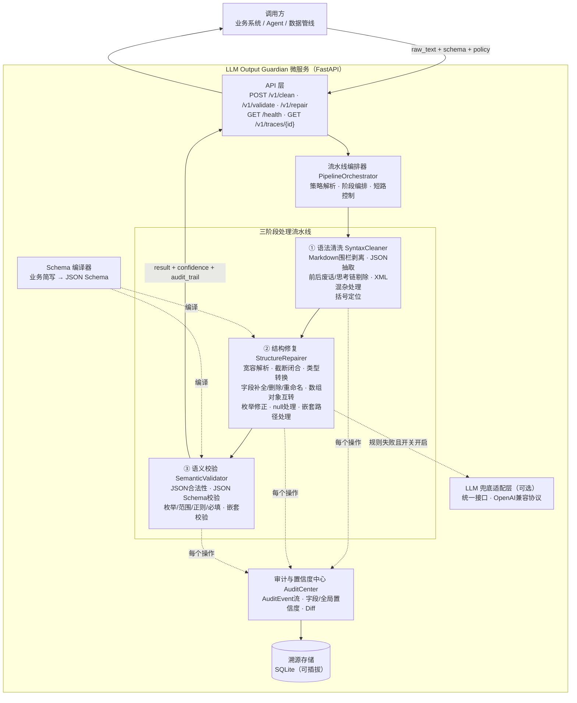
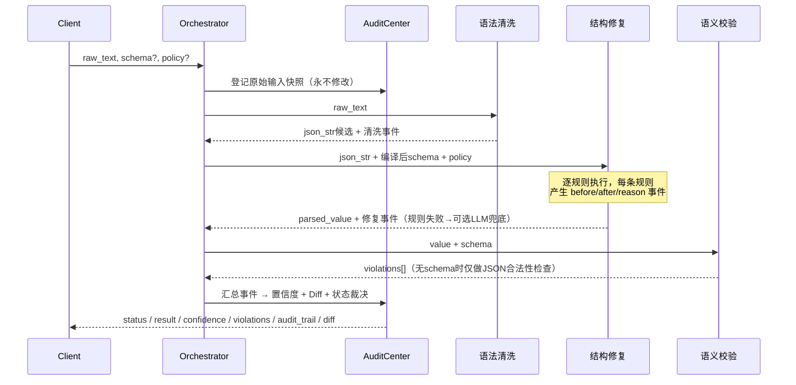

# LLM Output Guardian 设计文档

## 一、总体架构



## 二、数据流



## 三、核心设计

### 3.1 三阶段流水线

**① 语法清洗（SyntaxCleaner）** —— 纯文本处理，不改变数据语义

- Markdown 代码围栏识别与剥离（含流式截断导致的未闭合围栏）
- 思考链/前后废话剔除：字符串感知的括号配平定位 JSON 区间，多候选取最长
- XML/JSON 混杂处理：`<json>`、`<result>` 等标签包裹提取
- BOM、全角标点（｛｝［］：，）、零宽字符规范化
- 全程记录 `extract`/`strip`/`normalize` 事件

**② 结构修复（StructureRepairer）** —— 规则驱动，按规则目录逐条执行

- 解析顺序：严格 `json.loads` → 宽容文本修复 → 截断修复 →（可选）LLM 兜底
- 宽容解析（自研可控实现，避免黑盒库丢失审计粒度）：单引号、未引用 key、尾逗号、注释、Python 字面量、NaN（所有结构性替换仅作用于字符串字面量之外）
- 截断修复：未闭合字符串/对象/数组按栈补全；半截元素回退到上一个安全边界（`,`/`{`/`[`）丢弃，迭代至成功
- 类型转换：按 schema 目标类型安全转换，无法安全转换保留原值交语义校验，不硬转不猜值
- 字段操作：defaults 补全（支持点路径）、unknown_fields 删除/报错、rename_map 重命名（递归）
- 数组/对象互转：标量包裹、单元素解包、kv 列表与对象互转
- 枚举修正四级：精确 → 大小写/空白归一 → 别名映射 → rapidfuzz 模糊匹配（阈值默认 0.85，低于阈值不猜值）
- null 处理：nullable / null_policy（keep / default / error）

**③ 语义校验（SemanticValidator）**

- 无 schema：JSON 合法性（NaN/Infinity 检测）
- 有 schema：`jsonschema` Draft 7 校验，违规结构化输出 `path / keyword / message / expected / actual`

### 3.2 Schema 编译器

| 简写 | 编译结果 |
|---|---|
| `"age": "integer"` | `{"type": "integer"}` |
| `"gender": ["男","女"]` | `{"type": "string", "enum": [...]]}` |
| `"tags": ["string"]` | `{"type":"array","items":{"type":"string"}}` |
| 嵌套 dict | 递归编译为 `object` + `properties` |
| 键名 `xxx?` | 非必填 |

标准 JSON Schema 自动识别直传（`properties`/`items`/`required` 等结构性关键字），支持 `minimum`/`pattern` 等强约束。

### 3.3 置信度与溯源（AuditCenter）

每条不可变 `AuditEvent`：

```json
{
  "event_id": "evt_0001",
  "stage": "structure_repair",
  "action": "type_coercion",
  "path": "age",
  "before": "18",
  "after": 18,
  "reason": "schema要求integer，字符串可安全转换",
  "method": "rule",
  "confidence_delta": -0.10
}
```

- 字段级置信度：该字段事件罚分累加，截断到 [0,1]
- 全局置信度：schema 叶节点字段平均分 + 全局动作罚分（分类罚分封顶）
- LLM 参与修复：全局置信度封顶 0.6，事件强制 `method=llm`
- Diff：RFC6902 风格，不变量 `apply(diff, old) == result`（hypothesis 模糊测试验证）
- 状态裁决：`valid` / `repaired` / `invalid`（存在 error 违规即 invalid）

### 3.4 状态机

```
输入 ──► 定位JSON ──失败──► invalid (parse_error)
              │成功
              ▼
         规则修复 ──schema违规──► invalid
              │通过
              ▼
      有事件? ─是─► repaired
              │否
              ▼
            valid
```

## 四、置信度罚分表

完整配置见 [app/audit/scoring.yaml](../app/audit/scoring.yaml)：

| 动作 | 罚分 |
|---|---|
| 围栏剥离/废话剔除/XML提取 | -0.05 |
| 宽容解析（引号、尾逗号等） | -0.05/项，同类封顶 -0.15 |
| 截断修复 | -0.20 |
| 类型安全转换 | -0.10/字段 |
| 默认值补全 | -0.15/字段 |
| 枚举归一化/别名/模糊 | -0.05 / -0.10 / -0.25 |
| 未知字段删除 | -0.05/字段 |
| LLM 兜底参与 | 全局置信度封顶 0.6 |

## 五、技术决策记录

| 决策 | 理由 |
|---|---|
| 自研宽容解析器而非直接用 json-repair 库 | 每个修复动作必须可产生审计事件，黑盒库丢失溯源粒度 |
| 确定性规则优先，LLM 仅兜底 | 默认完全离线、结果 100% 可复现、零成本；LLM 结果不可复现且可能引入新错误 |
| LLM 兜底置信度封顶 0.6 | 下游可据置信度决定是否采信 LLM 修复结果 |
| 枚举模糊匹配低于阈值不猜值 | 宁可报违规交人工，不污染下游数据 |
| 罚分外置 scoring.yaml | 按业务容忍度调整，不硬编码 |
| 业务简写 + 标准 JSON Schema 双格式 | 简写降低上手门槛；范围/正则等强约束走标准 Schema |
| 溯源存储可插拔 | 敏感数据可关闭落库；后续可扩展脱敏钩子 |

## 六、风险与应对

| 风险 | 应对 |
|---|---|
| 模糊枚举匹配猜错值 | 高阈值默认（0.85），低于阈值保留原值报违规，事件记录匹配分数 |
| 严重截断补全后语义失真 | 截断修复重罚（-0.20），下游据置信度决定拒绝与否 |
| LLM 兜底不可复现/引入新错误 | 默认关闭；兜底结果必须再过完整语义校验；强制标记与封顶 |
| 解析器误修 | 语料回归 + hypothesis 模糊测试；规则可按 action 粒度禁用 |
| 敏感原始数据落库 | 存储可插拔（GUARDIAN_PERSIST=0 关闭） |
